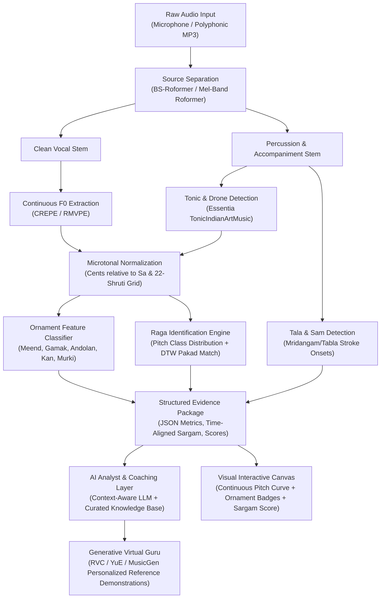

# Song Lab — Master Architecture, Research & Knowledge Index

*Central navigation hub and research compendium connecting music information retrieval (MIR), Indian classical raga intelligence, generative audio AI, and audio engineering pipelines.*

---

## 🗺️ Master Documentation Directory

Click any document below to navigate to the detailed specification and research logs:

```
                                  ┌────────────────────────┐
                                  │   Song Lab: INDEX.md   │
                                  │   (Master Directory)   │
                                  └───────────┬────────────┘
                                              │
         ┌───────────────────┬────────────────┼───────────────────┬───────────────────┐
         ▼                   ▼                ▼                   ▼                   ▼
┌──────────────────┐┌──────────────────┐┌──────────────────┐┌──────────────────┐┌──────────────────┐
│     plan.md      ││ system_architect ││ indian_classical ││ generative_music ││ audio_pipeline_  │
│                  ││ ure_and_impl.md  ││ _mir_ecosystem.md││ _ai.md           ││ and_tooling.md   │
├──────────────────┤├──────────────────┤├──────────────────┤├──────────────────┤├──────────────────┤
│ • Phase 2 Specs  ││ • 11 Components  ││ • CompMusic/MTG  ││ • Suno v3/v3.5/v4││ • BS-Roformer/UVR│
│ • Ornament Vocab ││ • Pros/Cons/Costs││ • compIAM/Saraga ││ • Udio & YuE     ││ • CREPE / RMVPE  │
│ • Dual-Mode Map  ││ • Realtime vs Bat││ • Tonic (Sa) Ess.││ • MusicGen/Bark  ││ • 22-Shruti Math │
│ • AI Analyst     ││ • Service Topology││ • Riyaz & iShala ││ • RVC / DiffSing ││ • MIDI MPE Bend  │
└──────────────────┘└──────────────────┘└──────────────────┘└──────────────────┘└──────────────────┘
                                              │
                        ┌─────────────────────┴─────────────────────┐
                        ▼                                           ▼
             ┌────────────────────┐                      ┌────────────────────┐
             │ research_compendium│                      │ ai_analyst_and_    │
             │ _and_papers.md     │                      │ rag_architecture   │
             ├────────────────────┤                      ├────────────────────┤
             │ • Chordia & Rae    │                      │ • Multi-Agent      │
             │ • Gulati TDMS      │                      │ • Knowledge Graph  │
             │ • DeepSRGM LSTM    │                      │ • JSON Evidence    │
             │ • Srinivasamurthy  │                      │ • Hallucination G  │
             └────────────────────┘                      └────────────────────┘
```

| Document | Primary Focus | Key Entities & Technologies Covered |
|---|---|---|
| 🏆 **[Finalized Product Blueprint](file:///d:/Music/FINALIZED_PRODUCT_BLUEPRINT.md)** | **Definitive Technical Moat & Consensus Specs** | **Consensus architecture from the exhaustive design interview**: 8 aligned pillars, un-replicable technical moat, kinematic-wavelet equations, 2-tier ornament logic, deficit state machine, edge-cloud split, and 6-phase engineering roadmap. |
| 📋 **[Phase 2 Specification Plan](file:///d:/Music/plan.md)** | Core System Architecture & Musical Design | Dual-Mode Taxonomy (Mode 1: Indian Classical/Gayaki vs. Mode 2: Western/Contemporary), Salience Filtering & "What Is Missing" Deficit Engine, Ornaments (Meend, Gamak, Andolan, Murki, Kan, Zamzama, etc.), Tonic ($Sa$), Sargam, 30 Raga knowledge base, Tala/Laya, AI Analyst. |
| 🏗️ **[System Architecture & Implementation Plan](file:///d:/Music/system_architecture_and_implementation_plan.md)** | **Backend Engineering & Component Breakdown** | **Deep-dive on all 11 backend components** with trade-offs (upsides, downsides, costs), service topology (FastAPI, PyTorch, Celery, Redis, Neo4j, pgvector), batch vs. real-time streaming pipelines, and infrastructure budget. |
| 🎶 **[Indian Classical MIR Ecosystem](file:///d:/Music/indian_classical_mir_ecosystem.md)** | Indian Art Music MIR Research & Products | MTG CompMusic, `compIAM`, Saraga datasets, Essentia `TonicIndianArtMusic`, NCPA/UvA AUTRIM, IIT Bombay DAP Lab, Riyaz app (MusicMuni), SwarShala, Sur Sadhana, GitHub raga classifiers, Kaggle datasets. |
| 🤖 **[Generative Music AI & Suno](file:///d:/Music/generative_music_ai.md)** | AI Music Generation & Singing Synthesis | Suno AI (v3, v3.5, v4, Bark), Udio, Beatoven.ai (Indian music AI), YuE (open-source Suno), Meta MusicGen & AudioCraft, Stable Audio Open, RVC (voice conversion), So-VITS-SVC, Virtual Guru generation. |
| ⚙️ **[Audio Pipeline & Tooling](file:///d:/Music/audio_pipeline_and_tooling.md)** | Signal Processing & Mathematical Pipeline | BS-Roformer & Mel-Band Roformer (UVR5), HT-Demucs, CREPE, RMVPE, Spotify Basic Pitch, 22-Shruti frequency-to-cent equations, DTW pakad search, 14-bit pitch-bend MIDI export. |
| 📚 **[Deep Research Compendium & Papers](file:///d:/Music/research_compendium_and_papers.md)** | Academic Bibliography & Performance Benchmarks | Chordia & Rae (PCD/PCDD), Gulati et al. (TDMS), Madhusudhan et al. (DeepSRGM), Salamon (Tonic), Srinivasamurthy (Tala DBNs), Ranjani (Quantization), Gowriprasad (Gharanas), and empirical shruti science. |
| 🔬 **[Paper Corpus Curation & Applications](file:///d:/Music/research_papers_curation_and_applications.md)** | **3,257-Paper Harvest & Component Mappings** | **Automated harvest of 3,257 papers from OpenAlex**, multi-stage drop filtering (removing 2,585 irrelevant/medical collisions), retaining 672 high-value MIR papers, and mapping top algorithms directly to Song Lab's components. Supported by machine-readable dataset: [curated_research_papers.json](file:///d:/Music/data/curated_research_papers.json). |
| 🧠 **[AI Analyst & RAG Architecture](file:///d:/Music/ai_analyst_and_rag_architecture.md)** | Multi-Agent Hierarchy & Knowledge Graph | Signal Agent $\leftrightarrow$ Reasoning Agent $\leftrightarrow$ Coach Agent, JSON Evidence schema, Raga Knowledge Graph, Bhatkhande RAG index, gharana conflict resolution, and anti-hallucination guardrails. |

---

## 🏗️ End-to-End System Architecture



---

## 📊 Comparative Research & Industry Matrix

| Pillar | Core Technical Challenge | State-of-the-Art Solutions | Leading Open Repositories | Leading Commercial Products | Song Lab Role |
|---|---|---|---|---|---|
| **Vocal Isolation** | Separating voice from tanpura drone & harmonium leak | Band-split spectral transformers, residual masking | `lucidrains/bs-roformer`, `facebookresearch/demucs` | UVR5, Moises.ai, RipX DAW | Phase 1/2 audio pre-processing frontend |
| **Tonic ($Sa$) Tracking** | Moving reference pitch across diverse singer keys | Multi-pitch salience peaks, harmonic product spectrum | `MTG/compIAM`, Essentia C++ | Riyaz (*Calibra™*), iShala, Tanpura Droid | Foundation of all raga & swara calculations |
| **Continuous Pitch ($F_0$)** | Tracking rapid glides without octave doubling | Convolutional neural networks, multiscale filters | `maxrmorrison/torchcrepe`, `Dream-High/RMVPE` | Melodyne, Antares Auto-Tune | Generates sub-cent pitch trajectories |
| **Ornament Detection** | Differentiating meend, gamak, andolan, and kan | First/second derivative dynamics, oscillatory energy | `hari2897/shruti-monitor`, `rajarshi51382/microtonal-carnatic` | SwarShala 5 | Core Phase 2 intelligence layer |
| **Raga Identification** | Capturing phrase grammar, vadi/samvadi, not just scales | Continuous Subsequence DTW, CNN-LSTM on pitch surfaces | `sohamm20/raag-identifier`, `ParampreetSingh97/PIM_v1_ExAI` | Tanarang, Chandrakantha | Explains song raga base & flags outside notes |
| **Generative Music** | Full-song synthesis with authentic vocal ornamentation | Autoregressive audio tokens, latent diffusion | `multimodal-art-projection/YuE`, `suno-ai/bark`, `facebookresearch/audiocraft` | Suno AI, Udio, Beatoven.ai | Generates reference audio, virtual guru drills, accompaniments |
| **Singing Synthesis / Voice** | Timbre transfer while preserving microtonal bends | VITS + HuBERT retrieval-based pitch tracking | `RVC-Project/Retrieval-based-Voice-Conversion`, `DiffSinger` | Kits.ai, ElevenLabs | Plays user's singing back in master timbre |

---

## 🔬 Key Research Datasets Reference

1. **Saraga IAM Dataset (Hindustani & Carnatic):**
   * [Saraga Carnatic on Zenodo (Record 4301735)](https://zenodo.org/records/4301735)
   * [Saraga Hindustani on Zenodo (Record 4301737)](https://zenodo.org/records/4301737)
   * Official Code & Parsers: [MTG/saraga on GitHub](https://github.com/MTG/saraga)
   * Essential for swara alignment, pitch tracking evaluation, and raga phrase dictionaries.
2. **Indian Art Music Tonic Dataset:**
   * Contains verified ground-truth tonics across hundreds of classical recordings ([CompMusic Dunya](https://dunya.compmusic.upf.edu/)).
3. **Mridangam & Tabla Stroke Datasets:**
   * [CompMusic Dunya Carnatic & Hindustani Rhythm Corpora](https://zenodo.org/records/1264667)
   * [guruprasanth02/Mridangam-stroke-detection on GitHub](https://github.com/guruprasanth02/Mridangam-stroke-detection)
   * [pranav6670/Detection-Classification-of-Tabla-taals on GitHub](https://github.com/pranav6670/Detection-Classification-of-Tabla-taals)
   * Used for training onset detectors and identifying metric cycles (*tala vibhags*).

---

## 🚀 Recommended Implementation Sequence

1. **Step 1 (Pre-processing):** Integrate `BS-Roformer` and `torchcrepe` / `RMVPE` to output clean pitch contours relative to time.
2. **Step 2 (Tonal Calibrator):** Port Essentia's `TonicIndianArtMusic` to lock $Sa$; map frequencies to 22-Shruti cent space.
3. **Step 3 (Heuristic Ornament Parser):** Deploy derivative filters and sliding autocorrelation to identify Western vibrato and Indian classical meend, kan, and andolan.
4. **Step 4 (Raga Matcher):** Build the 30-raga structured database and compare user pitch class profiles and DTW pakads against it.
5. **Step 5 (Virtual Guru & Analyst):** Integrate lightweight LLM structured analysis with `YuE` / `RVC` audio synthesis for reference audio playback.

---

*This document is the central hub for the Song Lab project repository. All technical documentation is cross-linked and maintained in the root workspace directory.*
