# AI Analyst, Multi-Agent System & Knowledge Graph Architecture

*System design specification for Section 8 of Phase 2: Multi-agent orchestration, structured evidence schemas, Raga Knowledge Graph, RAG citation engine, and guardrails.*

---

## Table of Contents
1. [Multi-Agent Orchestration Topology](#1-multi-agent-orchestration-topology)
2. [Structured Evidence Interface (Pipeline-to-LLM Schema)](#2-structured-evidence-interface-pipeline-to-llm-schema)
3. [Raga Knowledge Graph Architecture](#3-raga-knowledge-graph-architecture)
4. [Retrieval-Augmented Generation (RAG) & Citation Engine](#4-retrieval-augmented-generation-rag--citation-engine)
   - [Public Domain & Permissive Sources](#public-domain--permissive-sources)
   - [Hybrid Retrieval (Dense + Sparse BM25)](#hybrid-retrieval-dense--sparse-bm25)
   - [Conflict Resolution Protocol (Gharana Divergence)](#conflict-resolution-protocol-gharana-divergence)
5. [Hallucination Guardrails & Pedagogical Verification](#5-hallucination-guardrails--pedagogical-verification)
6. [Cross-Link Navigation](#6-cross-link-navigation)

---

## 1. Multi-Agent Orchestration Topology

To ensure zero hallucination of musical measurements, the AI Analyst operates as a hierarchical multi-agent system separating **quantitative acoustic facts** from **symbolic musicological reasoning** and **pedagogical coaching**:

```
                       User Prompt / Singing Performance
                                       │
                                       ▼
                     ┌───────────────────────────────────┐
                     │    Supervisor / Orchestrator      │
                     └─────────────────┬─────────────────┘
                                       │
         ┌─────────────────────────────┼─────────────────────────────┐
         ▼                             ▼                             ▼
┌──────────────────┐         ┌──────────────────┐          ┌──────────────────┐
│  Signal Tooling  │         │  Musicological   │          │   Pedagogical    │
│  Agent           │         │  Reasoning Agent │          │   Coaching Agent │
├──────────────────┤         ├──────────────────┤          ├──────────────────┤
│ • Calls CREPE /  │         │ • Traverses Raga │          │ • Analyzes user  │
│   Essentia       │         │   Knowledge Graph│          │   weaknesses     │
│ • Runs DTW Pakad │         │ • Computes rule  │          │ • Formulates     │
│   Search         │         │   violations     │          │   alankar drills │
│ • Returns raw    │         │ • Resolves       │          │ • Synthesizes    │
│   JSON metrics   │         │   gharana rules  │          │   practice plans │
└────────┬─────────┘         └────────┬─────────┘          └────────┬─────────┘
         │                            │                             │
         └────────────────────────────┼─────────────────────────────┘
                                      │
                                      ▼
                      Synthesized Verified Response
                      (With Audio Timestamps & Citations)
```

1. **Signal Tooling Agent:** Communicates with the low-level Python/C++ pipeline (Essentia, BS-Roformer, torchcrepe). It never talks to the user directly; it runs analyses on demand (e.g., *"Isolate bars 12–16 and compute vibrato rate"*).
2. **Musicological Reasoning Agent:** Receives the compact JSON evidence packet. It queries the Raga Knowledge Graph and vector database to verify whether deviations are intentional stylistic ornaments (*vivadi* usage or *chalan*) or singing errors.
3. **Pedagogical Coaching Agent:** Translates musicological diagnostics into actionable, encouraging feedback tailored to the user's vocal range and experience level.

---

## 2. Structured Evidence Interface (Pipeline-to-LLM Schema)

The LLM is **never fed raw audio bytes**. It receives a structured, compact JSON document containing measured acoustic facts. This guarantees minimal token usage, eliminates acoustic hallucination, and makes the model fully deterministic:

```json
{
  "session_id": "take_20261021_049",
  "global_metrics": {
    "detected_tonic_hz": 146.83,
    "tonic_name": "D3",
    "tonic_confidence": 0.96,
    "tempo_bpm": 88.5,
    "detected_tala": "Teentaal",
    "tala_sam_timestamps": [1.42, 12.28, 23.14, 34.00],
    "total_voiced_duration_s": 42.6
  },
  "swara_distribution": [
    {"swara": "Sa", "ratio": 1.0, "time_spent_pct": 24.1, "mean_cent_deviation": +1.2},
    {"swara": "Re_shuddha", "ratio": 1.125, "time_spent_pct": 18.5, "mean_cent_deviation": -3.8},
    {"swara": "Ga_shuddha", "ratio": 1.25, "time_spent_pct": 22.0, "mean_cent_deviation": +2.1},
    {"swara": "Ma_tivra", "ratio": 1.406, "time_spent_pct": 14.2, "mean_cent_deviation": +6.4},
    {"swara": "Pa", "ratio": 1.5, "time_spent_pct": 21.2, "mean_cent_deviation": +0.8}
  ],
  "detected_ornaments": [
    {
      "type": "meend",
      "start_time": 4.21,
      "end_time": 4.88,
      "from_swara": "Pa",
      "to_swara": "Ga_shuddha",
      "velocity_cents_per_s": -560.2,
      "monotonicity": 0.98,
      "target_accuracy_cents": +4.1
    },
    {
      "type": "andolan",
      "start_time": 14.10,
      "end_time": 16.32,
      "center_swara": "Ga_komal",
      "oscillation_rate_hz": 2.1,
      "depth_cents": 140.0
    }
  ],
  "raga_matching": {
    "top_candidates": [
      {
        "raga": "Yaman",
        "confidence": 0.92,
        "matched_pakads": ["N_R_G", "m_D_N_S_dot"],
        "forbidden_swaras_detected": []
      },
      {
        "raga": "Bhupali",
        "confidence": 0.61,
        "matched_pakads": ["G_R_S_D_dot_S"],
        "forbidden_swaras_detected": ["Ma_tivra", "Ni_shuddha"]
      }
    ]
  }
}
```

---

## 3. Raga Knowledge Graph Architecture

The knowledge base is structured as a property graph (using Neo4j or NetworkX) encoding verified musicological relationships:

```mermaid
graph TD
    R_Yaman["Raga: Yaman\n(Kalyan)"]
    T_Kalyan["Thaat: Kalyan"]
    S_Sa["Swara: Sa (S)"]
    S_Re["Swara: Shuddha Re (R)"]
    S_Ga["Swara: Shuddha Ga (G)"]
    S_MaT["Swara: Tivra Ma (m)"]
    S_Pa["Swara: Pa (P)"]
    S_Dha["Swara: Shuddha Dha (D)"]
    S_Ni["Swara: Shuddha Ni (N)"]
    
    P_Pakad1["Pakad: 'Ni Re Ga, Re Sa'"]
    P_Pakad2["Pakad: 'Pa Re, Ga Re Sa'"]
    
    R_Yaman -->|PARENT_THAAT| T_Kalyan
    R_Yaman -->|VADI| S_Ga
    R_Yaman -->|SAMVADI| S_Ni
    R_Yaman -->|INCLUDES_SWARA| S_Sa & S_Re & S_Ga & S_MaT & S_Pa & S_Dha & S_Ni
    R_Yaman -->|CHARACTERISTIC_PHRASE| P_Pakad1 & P_Pakad2
    R_Yaman -->|PRAHAR| Night_First_Prahar["First Prahar of Night (6 PM - 9 PM)"]
    R_Yaman -->|RASA| Shringara_Shanta["Shringara & Shanta (Devotion & Peace)"]
```



### Knowledge Graph Node & Edge Types
* **Nodes:** `Raga`, `Thaat`, `Swara`, `Pakad`, `Bandish`, `Composer`, `Gharana`, `Tala`, `FilmSong`.
* **Key Properties on Raga Node:**
  * `jati_aroha`: Audava (5), Shadava (6), or Sampurna (7).
  * `jati_avaroha`: Number of descending notes.
  * `varjya_swaras`: Notes strictly prohibited in normal movement.
  * `vakra_swaras`: Notes that require non-linear zigzag execution.
  * `nyasa_swaras`: Notes designated for resting and phrase endings.

---

## 4. Retrieval-Augmented Generation (RAG) & Citation Engine

### Public Domain & Permissive Sources
To avoid copyright infringement and legal risks, the RAG knowledge index is built exclusively from vetted, legally compliant materials:
1. **Historical Treatises (Public Domain):**
   * Bharata Muni's *Natyashastra* (Sanskrit core, public domain).
   * Sharngadeva's *Sangita Ratnakara* (13th Century).
   * Vishnu Narayan Bhatkhande's foundational 6-volume collection: *Hindustani Sangeet Paddhati* and *Kramik Pustak Malika* (author passed away in 1936; original Hindi/Marathi texts in public domain under Indian copyright law).
2. **Open-Access Scientific Research:**
   * ISMIR, DAFx, and ICASSP open-access proceedings (CompMusic, Saraga, MTG publications under CC-BY licenses).
3. **Curated Open Data:**
   * MusicBrainz and acoustic dataset metadata.
4. **Third-Party Copyrighted Modern Books:**
   * Handled via **metadata bibliography entries only** (e.g., citing Joep Bor's *The Raga Guide* or Nazir Jairazbhoy without ingesting protected text).

### Hybrid Retrieval (Dense + Sparse BM25)
Musical queries often include exact Sanskrit/Hindi terminology (*"vadi"*, *"nyasa"*, *"madhyam"*, *"andolan"*) that generic dense semantic embedding models dilute.
* **Retrieval Pipeline:**
  $$\text{Score}(q, d) = \alpha \cdot \text{DenseScore}(\text{BGE-M3}(q), \text{BGE-M3}(d)) + (1 - \alpha) \cdot \text{BM25}(q, d)$$
  Where $\alpha \approx 0.65$. BM25 ensures exact swara and raga spelling matches, while dense vectors handle conceptual intent (*"Why is my slide sounding abrupt?"*).

### Conflict Resolution Protocol (Gharana Divergence)
Classical music traditions frequently dispute nuances (e.g., whether Raga Bhupali's nyasa is Ga or Dha, or whether a touching komal Ni is permissible in a particular thumri style).
* **System Policy:** The AI Analyst **must never pick a winner silently**. It reports both traditions explicitly:
  > *"According to the Bhatkhande tradition, Gandhar is the primary Vadi note; however, certain Agra and Gwalior gharana lineages treat Dhaivat with equal emphasis. Your sustained rest on Ga conforms cleanly to Bhatkhande's classification [Source: Bhatkhande, Kramik Pustak Malika, Vol. 3, p. 88]."*

---

## 5. Hallucination Guardrails & Pedagogical Verification

The system enforces strict behavioral and factual guardrails through an output validation interceptor:

1. **Measurement vs. Interpretation Separation:**
   * The model must use distinct phrasing for raw pipeline output vs. qualitative advice:
     * *Measured Fact:* "Your Re to Ga transition took 340 milliseconds with an oscillation depth of 75 cents."
     * *Qualitative Advice:* "To achieve the characteristic float of Raga Desh, try softening the attack on Re."
2. **Citation Requirement:**
   * Every claim regarding raga rules, vadi/samvadi, or prahar must link directly to a node ID in the Knowledge Graph or a cited treatise chunk.
3. **No Guru Infallibility Claim:**
   * The AI explicitly introduces itself as an acoustic feedback tool and practice companion, reminding the learner that a human guru is the final authority on artistic aesthetic expression.
4. **Grammar-Constrained Reference Synthesis:**
   * When invoking generative music models (e.g., YuE, MusicGen, or RVC) to play a reference drill, the system applies an explicit **scale-degree logit mask** to prevent the model from generating forbidden (*varjya*) swaras.

---

## 6. Cross-Link Navigation

* 📖 **[Master Documentation Hub](file:///d:/Music/INDEX.md)**: Main architecture and directory.
* 📋 **[Phase 2 Specification Plan](file:///d:/Music/plan.md)**: Core design goals and coaching roadmap.
* 🎶 **[Indian Classical MIR Ecosystem](file:///d:/Music/indian_classical_mir_ecosystem.md)**: CompMusic, Saraga, compIAM, Essentia, and commercial apps.
* 🤖 **[Generative Music AI & Suno](file:///d:/Music/generative_music_ai.md)**: Suno, Udio, YuE, MusicGen, and voice conversion.
* ⚙️ **[Audio Engineering & Signal Pipeline](file:///d:/Music/audio_pipeline_and_tooling.md)**: Separation, pitch extraction, and 22-shruti math.
* 📚 **[Deep Research Compendium & Papers](file:///d:/Music/research_compendium_and_papers.md)**: Academic bibliography, ISMIR papers, TDMS, DeepSRGM, and benchmark accuracies.
