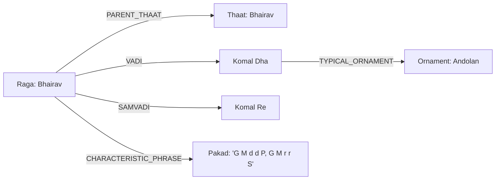

# Song Lab — System Architecture & Component Implementation Plan

*Comprehensive backend engineering blueprint, architectural topology, component-by-component trade-off evaluations (upsides, downsides, costs), and service infrastructure. (Frontend deferred per design directive).*

---

## Table of Contents
1. [Executive Architectural Vision & Core Philosophy](#1-executive-architectural-vision--core-philosophy)
2. [High-Level Service Topology & Dual-Engine Architecture](#2-high-level-service-topology--dual-engine-architecture)
3. [Deep-Dive Component Breakdown](#3-deep-dive-component-breakdown)
   - [Component 1: Audio Ingestion, Pre-Processing & Source Demixing](#component-1-audio-ingestion-pre-processing--source-demixing)
   - [Component 2: Continuous Pitch Extraction ($F_0$) & Voicing Detection](#component-2-continuous-pitch-extraction-f_0--voicing-detection)
   - [Component 3: Tonal Normalization, Tonic ($Sa$) Tracking & 22-Shruti Engine](#component-3-tonal-normalization-tonic-sa-tracking--22-shruti-engine)
   - [Component 4: Dual-Mode Ornament & Expression Classifier](#component-4-dual-mode-ornament--expression-classifier)
   - [Component 5: The "What Is Missing" & Salience Filtering Engine](#component-5-the-what-is-missing--salience-filtering-engine)
   - [Component 6: Raga Intelligence, Phrase Search & Grammar Engine](#component-6-raga-intelligence-phrase-search--grammar-engine)
   - [Component 7: Rhythm, Tala & Laya Tracking Engine](#component-7-rhythm-tala--laya-tracking-engine)
   - [Component 8: Knowledge Base & Raga Knowledge Graph](#component-8-knowledge-base--raga-knowledge-graph)
   - [Component 9: AI Analyst & Multi-Agent Orchestration](#component-9-ai-analyst--multi-agent-orchestration)
   - [Component 10: Generative Audio & Virtual Guru Synthesis](#component-10-generative-audio--virtual-guru-synthesis)
   - [Component 11: Data Management, Cache & Storage Architecture](#component-11-data-management-cache--storage-architecture)
4. [End-to-End Dataflow Pipelines](#4-end-to-end-dataflow-pipelines)
   - [Pipeline A: Asynchronous Batch Song Package Analyzer](#pipeline-a-asynchronous-batch-song-package-analyzer)
   - [Pipeline B: Low-Latency Real-Time Live Coaching Stream](#pipeline-b-low-latency-real-time-live-coaching-stream)
5. [Overall Cost, Latency & Infrastructure Matrix](#5-overall-cost-latency--infrastructure-matrix)
6. [Cross-Link Navigation](#6-cross-link-navigation)

---

## 1. Executive Architectural Vision & Core Philosophy

### The Core Objective
Song Lab is designed to solve the fundamental divide in Music Information Retrieval (MIR):
1. **Western MIR tools** assume discrete, tempered 12-TET notes and harmonic chord progressions. They fail completely on the continuous, microtonally fluid, non-tempered nature of Indian Classical and expressive global vocal performance.
2. **Current Indian Classical apps** are either simple tuner clones (giving a static pass/fail on whether you hit *Sa* or *Pa*) or static audio player repositories. None provide continuous phrase-level understanding, ornament evaluation, or explainable pedagogical intelligence.
3. **Song Lab's Mission:** Build an end-to-end, deterministic acoustic-intelligence pipeline that measures continuous pitch, isolates ornaments (*meend, gamak, andolan, murki, kan*), identifies ragas and talas, filters out line-by-line clutter to focus on **what the singer is missing**, and contextualizes everything through a conversational AI Analyst and a Generative Virtual Guru.

### Architectural Principles
* **No Raw Audio into LLMs:** Audio is never passed to generative LLMs directly. The signal processing layer transforms raw sound into a compact, deterministic **Structured Evidence JSON**. LLMs only perform reasoning and explanation over verified numbers.
* **Separation of Real-Time vs. Batch:** Real-time coaching requires $< 40\text{ ms}$ processing latencies; complex source demixing and whole-song raga matching can tolerate asynchronous background worker processing ($5–20\text{ s}$).
* **Explainability Over Black-Box Classification:** Every prediction (e.g., *"This is Raga Yaman"*) must output mathematical timestamps, matched pakad phrases, and cent deviations, never just an opaque label.
* **Deficit-First Feedback:** To avoid cognitive overload, the system stays quiet when execution is standard, concentrating its feedback on the crucial missing nuances.

---

## 2. High-Level Service Topology & Dual-Engine Architecture

```
                                      ┌───────────────────────────────┐
                                      │   Client Applications / DAW   │
                                      │   (Audio In / Structured Out) │
                                      └───────────────┬───────────────┘
                                                      │
                                                      ▼
                                      ┌───────────────────────────────┐
                                      │   Kong / Envoy API Gateway    │
                                      │   (Auth, Rate Limiting, WS)   │
                                      └───────┬───────────────┬───────┘
                                              │               │
                      ┌───────────────────────┘               └───────────────────────┐
                      │ [WebSocket: Real-time Audio]                  │ [REST: Song Upload]
                      ▼                                               ▼
         ┌─────────────────────────┐                     ┌─────────────────────────┐
         │ Real-Time Live Engine   │                     │ Batch Ingestion Engine  │
         │ (Low-Latency Streamer)  │                     │ (Asynchronous Workers)  │
         ├─────────────────────────┤                     ├─────────────────────────┤
         │ • Sliding Window Audio  │                     │ • Full Demixing (Roform)│
         │ • RMVPE / torchcrepe    │                     │ • Complete Stem Package │
         │ • Heuristic Ornament    │                     │ • DeepSRGM / TDMS Raga  │
         │   Classifier            │                     │ • Bayesian Tala Parser  │
         │ • Delta Deficit Detector│                     │ • Celery / Redis Queue  │
         └────────────┬────────────┘                     └────────────┬────────────┘
                      │                                               │
                      └───────────────────────┬───────────────────────┘
                                              │
                                              ▼
                                 ┌─────────────────────────┐
                                 │ Structured Evidence Bus │
                                 │ (Kafka / RabbitMQ)      │
                                 └────────────┬────────────┘
                                              │
         ┌────────────────────────────────────┼────────────────────────────────────┐
         ▼                                    ▼                                    ▼
┌──────────────────┐                 ┌──────────────────┐                 ┌──────────────────┐
│ Raga Intelligence│                 │ AI Analyst       │                 │ Generative Audio │
│ & Grammar Engine │                 │ Multi-Agent Hub  │                 │ Guru Service     │
├──────────────────┤                 ├──────────────────┤                 ├──────────────────┤
│ • 22-Shruti Cents│                 │ • Signal Tooler  │                 │ • YuE Foundation │
│ • Neo4j Raga KG  │                 │ • Music Reasoner │                 │ • RVC v2 Voice   │
│ • DTW Phrase Match│                │ • Pedagogic Coach│                 │ • Logit-Masked   │
│ • Vadi/Samvadi   │                 │ • Hybrid RAG     │                 │   Raga Synthesizer│
└──────────────────┘                 └──────────────────┘                 └──────────────────┘
```

The system is partitioned into two distinct operational flows:
1. **The Batch Ingestion Engine:** Handles full reference track processing, master stem separation, exhaustive raga profiling, and deep structural mapping. Runs asynchronously across GPU clusters.
2. **The Real-Time Live Engine:** Processes live microphone input during singing practice with lightweight, causal streaming pitch and ornament inference models ($< 35\text{ ms}$ processing time per frame).

---

## 3. Deep-Dive Component Breakdown

---

### Component 1: Audio Ingestion, Pre-Processing & Source Demixing

#### What It Does
Accepts multi-format user uploads (MP3, WAV, FLAC, M4A) or live microphone buffers; standardizes sample rates to 44.1kHz mono; cleans up DC offset; and strips background accompaniment (tanpura hum, harmonium leakage, tabla transients) to output an isolated, pristine vocal stem.

#### Evaluated Approaches
* **Approach A: Monolithic Standard Spleeter (2-stem)**
  * Fast, low compute footprint.
* **Approach B: HT-Demucs v4 (4-stem)**
  * Good musical separation, but high bleed between voice and high-frequency harmonium/tanpura strings.
* **Approach C: Band-Split Roformer (BS-Roformer) + Mel-Band Roformer Ensemble (Chosen)**
  * State-of-the-art SDR (> 12.8 dB) on vocal demixing. Accurately isolates high overtones of Indian singing without phase smearing.

#### Architecture & Services
* **Service:** `vocal-demux-worker`
* **Core Libraries:** PyTorch, `bs-roformer`, `torchaudio`, `scipy.signal`
* **Deployment:** Distributed Celery worker pool running on NVIDIA L4 or T4 GPUs.
* **Pipeline:** Audio In $\rightarrow$ High-pass filter ($30\text{ Hz}$) $\rightarrow$ BS-Roformer Vocal Separation $\rightarrow$ Adaptive Tanpura Notch Filter ($Sa_1, Sa_2, Pa$ fundamental removal) $\rightarrow$ Clean Vocal Stem.

#### Trade-Off Analysis
* **Upsides:**
  * Cleanest vocal isolation in modern MIR; removes tabla bleed that causes false pitch attacks.
  * Preserves delicate high-register transients critical for recognizing fast *murkis* and *kans*.
* **Downsides:**
  * Computationally expensive: processing a 4-minute song takes ~6–9 seconds on an NVIDIA T4 GPU.
  * Cannot run locally on mobile hardware in real-time.
* **Cost & Latency:**
  * GPU compute: ~$0.003 per minute of processed audio on cloud spot instances.
  * Batch turnaround: 10 seconds total turnaround for user upload.

---

### Component 2: Continuous Pitch Extraction ($F_0$) & Voicing Detection

#### What It Does
Computes the continuous fundamental pitch trajectory ($f_0$ in Hertz) at 100 Hz (10 ms hop size) alongside a binary and continuous voicing confidence metric ($V \in [0.0, 1.0]$).

#### Evaluated Approaches
* **Approach A: Classical Signal Processing (pYIN / SWIPEP)**
  * Pure CPU, zero GPU requirements. Highly prone to octave doubling errors during rapid taans and unable to track heavily modulated gamaks.
* **Approach B: torchcrepe (CREPE Large)**
  * Exceptional sub-cent precision across 360 pitch bins. Very heavy computationally (~3x real-time on CPU).
* **Approach C: RMVPE (Robust Multiscale Vocal Pitch Estimation) — (Chosen for Live) + torchcrepe (Chosen for Reference Batch)**
  * RMVPE achieves state-of-the-art accuracy with a lightweight multiscale convolutional backbone, delivering $< 15\text{ ms}$ inference on modern CPUs/GPUs.

#### Architecture & Services
* **Service:** `pitch-extractor-service` (Embedded C++/CUDA shared library for real-time; PyTorch inference worker for batch).
* **Core Libraries:** `RMVPE` (C++ inference engine via ONNX Runtime), `torchcrepe` (for gold-standard offline reference tracks).
* **Streaming Capability:** Causal 1024-sample sliding buffer with 512-sample hop size ($11.6\text{ ms}$ window latency at 44.1kHz).

#### Trade-Off Analysis
* **Upsides:**
  * Near-zero octave jumping errors on Indian ornamentation.
  * High-precision voicing confidence prevents background silence or breath intakes from corrupting pitch calculations.
* **Downsides:**
  * Slight latency penalty ($10-15\text{ ms}$) on live streaming buffers.
* **Cost & Latency:**
  * Memory footprint: ~120 MB RAM.
  * CPU Usage: < 15% of a single modern x86/ARM core during live 44.1kHz streaming.

---

### Component 3: Tonal Normalization, Tonic ($Sa$) Tracking & 22-Shruti Engine

#### What It Does
Determines the singer's movable fundamental reference pitch ($Sa$) in Hertz; normalizes the continuous frequency contour into cents relative to $Sa$; maps frequencies onto the 22-Shruti Just Intonation matrix; and tracks slow global tonic drift across extended performances.

#### Evaluated Approaches
* **Approach A: Manual Tonic Input Only**
  * Requires user to know their exact pitch key (e.g., C# / Black 1). Confuses beginners and fails if the singer performs slightly off standard pitch (e.g., A = 432 Hz or C# + 15 cents).
* **Approach B: Dominant Peak Histogram on Vocal Track**
  * Fails if the singer spends more time dwelling on *Pa* or *Vadi swara* than on *Sa*.
* **Approach C: Multipitch Drone Salience Correlation (Essentia `TonicIndianArtMusic` adapted) + Vocal Rest Consensus + Dynamic Kalman Drift Filter (Chosen)**
  * Simultaneously detects stationary peaks in the tanpura accompaniment stem ($Sa_1, Sa_2, Pa$) and correlates them with the vocal rest plateaus (*nyasa*). A Kalman filter continuously updates $Sa(t)$ to compensate for organic vocal warming drift ($10-30\text{ cents}$).

#### Architecture & Services
* **Service:** `tonal-calibration-engine`
* **Core Libraries:** `numpy`, `scipy`, adapted C++ `TonicIndianArtMusic`, `filterpy` (Kalman filtering).
* **Mathematical Formula:**
  $$\text{Cents}(t) = 1200 \times \log_2\left(\frac{f_0(t)}{Sa(t)}\right)$$

#### Trade-Off Analysis
* **Upsides:**
  * Fully automated tonic detection with zero user friction.
  * Handles microtonal nuances: recognizes when a note is intentionally sung lower (e.g., *Todi komal Ga* at 294 cents) versus an accidental flat error.
* **Downsides:**
  * If a raw acappella recording lacks both drone and clear resting notes on *Sa*, confidence drops; requires a lightweight UI fallback allowing the user to tap-confirm their root key.
* **Cost & Latency:**
  * Deterministic mathematics; $< 5\text{ ms}$ execution time on CPU. Zero GPU cost.

---

### Component 4: Dual-Mode Ornament & Expression Classifier

#### What It Does
Segments the continuous cent curve into distinct musical gestures and labels them across two interchangeable vocabularies:
* **Mode 1 (Indian Classical):** *Meend, Gamak, Andolan, Murki, Khatka, Kan Swar, Zamzama, Sapaat Taan, Vakra Taan, Swar Sthirata, etc.*
* **Mode 2 (Western Contemporary):** *Portamento, Glissando, Vibrato, Tremolo, Melisma, Vocal Run, Trill, Mordent, Grace Note, Straight Tone, Belting, etc.*

#### Evaluated Approaches
* **Approach A: End-to-End Blackbox Audio Classifier (AST / Audio Spectrogram Transformer)**
  * High classification accuracy on training benchmarks, but zero interpretability. Cannot explain *why* something is a meend vs. a kan, and cannot evaluate physical execution quality (*safai, gahraai, barabari*).
* **Approach B: Hybrid Architecture — Rule-Based Kinematic Filters (Tier 1) + Bi-LSTM Gamaka Sequence Model (Tier 2) — (Chosen)**
  * **Tier 1 (Physics/Kinematics):** Explicit mathematical rules over first derivative (pitch velocity $v = dC/dt$) and second derivative (pitch acceleration $a = d^2C/dt^2$), energy envelope crest factor, and sliding window autocorrelation.
  * **Tier 2 (Machine Learning):** A lightweight bidirectional LSTM that consumes feature vectors of detected kinematic segments to classify edge cases and contextual gharana variations.

#### Kinematic Decision Logic

```
                            Kinematic Segment C(t)
                                      │
         ┌────────────────────────────┼────────────────────────────┐
         ▼                            ▼                            ▼
  Duration < 80ms &            Monotonic Velocity            Periodic Oscillation
  |v| > 3500 cents/s           |ΔC| ≥ 180 cents              Detrended Autocorrelation
         │                            │                            │
         ▼                            ▼                            ▼
    Kan / Sparsh                Meend / Glide                 Frequency Check
    (Grace Note)                 (Portamento)                      │
                                                     ┌─────────────┴─────────────┐
                                                     ▼                           ▼
                                                1.0 – 3.0 Hz                4.5 – 7.5 Hz
                                               Andolan / Slow              Vibrato / Fast
                                                 (Darbari Ga)              (Western / Shimmer)
```

#### Trade-Off Analysis
* **Upsides:**
  * 100% explainable metrics: can report exact oscillation rate (Hz), glide velocity (cents/s), and turn duration (ms).
  * Direct measurement of execution quality (*Taan Ki Safai, Gamak Ki Gahraai, Meend Ki Lambai*).
* **Downsides:**
  * Requires carefully calibrated kinematic thresholds; must be tuned across diverse vocal registers (soprano vs. bass).
* **Cost & Latency:**
  * Tier 1 runs in $< 2\text{ ms}$ on CPU.
  * Tier 2 LSTM inference requires $< 5\text{ MB}$ RAM and $< 10\text{ ms}$ processing time.

---

### Component 5: The "What Is Missing" & Salience Filtering Engine

#### What It Does
Solves the critical UX failure mode of automated singing analysis: **line-by-line clutter**. Instead of labeling every standard note on every bar with dozens of distracting tags, the engine uses a **3-Tier Salience Filter** to suppress expected musical events and focuses active feedback exclusively on **what the singer is missing**.

#### Evaluated Approaches
* **Approach A: Exhaustive Tagging (Naive Approach)**
  * Outputs every detected feature (`[C4] [Chest Voice] [Straight Note] [In-tune] [No Vibrato]`). Result: Severe user cognitive overload; unreadable UI.
* **Approach B: Heuristic Error Thresholding Only**
  * Flags notes only when pitch error exceeds $\pm 50\text{ cents}$. Misses musical soul: marks an in-tune flat straight note as "perfect" even if the raga strictly requires a deep oscillating *gamak*.
* **Approach C: Dynamic Reference Delta & Salience Gating Engine (Chosen)**
  * Compares user take against an encoded **Raga Grammar Template** or **Master Take Reference Curve**:
    1. *Expected Event Match:* User sings an expected note or standard scalar step $\rightarrow$ Marked as silent baseline (zero text tags).
    2. *Milestone Execution:* User renders a clean *Murki* or smooth *Meend* $\rightarrow$ Marked with subtle, non-intrusive glyph above contour.
    3. *The Aesthetic Deficit:* Where an essential raga ornament or vocal technique was omitted $\rightarrow$ Generates prioritized **Deficit Callout Badge** (`[⚠️ Missing Gamak Ki Gahraai]`, `[⚠️ Missing Meend Ki Lambai]`, `[⚠️ Missing Mixed Voice Support]`).

#### Deficit Resolution Matrix

| Target In Raga / Master Take | What User Actually Sang | Engine Diagnostic Output (Mode 1: Indian Gayaki) | Engine Diagnostic Output (Mode 2: Western Studio) |
|---|---|---|---|
| Deep *Andolan* on Komal Ga (Darbari) | Flat, stationary straight pitch | `Missing: Andolan Ki Gati & Gahraai (Sung as static plate)` | `Missing: Pitch Modulation / Slow Vibrato` |
| Continuous *Meend* ($Pa \rightarrow Ga$) | Staccato jump between notes | `Missing: Meend Ki Lambai (Abrupt transition detected)` | `Missing: Portamento / Connected Legato Slide` |
| Touching *Kan* from Ma to Ga | Direct scalar step | `Missing: Kan Swar Prayog (Sparsh note omitted)` | `Missing: Grace Note / Acciaccatura` |
| Rhythmic Sapaat Taan | Uneven timing at beat 6 | `Missing: Taan Ki Barabari (Metric rushing detected)` | `Missing: Rhythmic Precision in Vocal Run` |
| Sustained Shadja ($Sa$) | Trembling pitch waver | `Missing: Swar Ka Thehraav / Sthirata (Vocal tremor)` | `Missing: Straight Tone / Pitch Stability` |
| High Climax Belt ($G_4$) | Weak, breathy falsetto | `Missing: Aawaz Ka Vazan / Swar Lagav` | `Missing: Mixed Voice & Diaphragmatic Breath Support` |

#### Trade-Off Analysis
* **Upsides:**
  * Clean, professional, clutter-free user experience.
  * Direct alignment with human vocal gurus who never comment on what was normal, but always critique what was omitted.
* **Downsides:**
  * Requires high-quality raga templates and phrase dictionaries to define what is "expected".
* **Cost & Latency:**
  * Lightweight vector subtraction and threshold comparison; runs in $< 1\text{ ms}$.

---

### Component 6: Raga Intelligence, Phrase Search & Grammar Engine

#### What It Does
Computes pitch class presence and directional transitions; executes subsequence dynamic time warping (DTW) to match canonical *pakad* phrases; checks adherence to *vadi, samvadi, nyasa, and varjya* swara rules; and outputs probabilistic ranking of candidate ragas with evidence timestamps.

#### Evaluated Approaches
* **Approach A: Simple Scale Degree Set Matching**
  * Compares pitch classes to 12-TET notes. Completely fails to distinguish between parent/child scales sharing identical notes (e.g., *Bhupali* vs. *Deshkar*, *Marwa* vs. *Puriya*).
* **Approach B: Pitch-Class Dyad Distributions (PCDD) + Continuous Subsequence DTW (Chosen)**
  * **PCD & PCDD Matrix:** Captures time allocation and directional step probabilities ($P(S_j \mid S_i)$).
  * **DTW Pakad Search:** Slides reference pitch contours of canonical pakads (stored in cent space) across the user's pitch trajectory using normalized Euclidean distance with elastic time alignment.
  * **Rule Engine:** Subtracts penalty scores if forbidden (*varjya*) notes are detected (e.g., natural *Ma* in *Yaman*).

#### Architecture & Services
* **Service:** `raga-intelligence-service`
* **Core Libraries:** `fastdtw`, `scipy.spatial`, `numpy`, custom C++ sequence aligner.
* **Output Format:** Top 3–5 candidates with percentage confidence, matched pakad timestamps, and outside note lists.

#### Trade-Off Analysis
* **Upsides:**
  * Works on film songs and classical pieces alike: correctly outputs *"Closest to Yaman (82%), but uses borrowed Western notes in the bridge"*.
  * 100% explainable evidence provided to the AI Analyst.
* **Downsides:**
  * Highly intricate, non-linear ragas (*vakra* ragas like *Chayanat* or *Gaud Malhar*) require multi-phrase templates rather than single scales.
* **Cost & Latency:**
  * Fast-DTW search against 30 foundational ragas completes in $< 350\text{ ms}$ on standard CPU.

---

### Component 7: Rhythm, Tala & Laya Tracking Engine

#### What It Does
Identifies the underlying metric framework beyond simple BPM: determines the **Tala cycle** (e.g., *Teentaal, Keherwa, Dadra, Ektaal, Rupak*), identifies the **Sam** (first beat) and **Khali** (empty beat), measures **Laya** (tempo class: *vilambit, madhya, drut*), and detects tempo drift.

#### Evaluated Approaches
* **Approach A: Standard Western Beat Trackers (Madmom / Librosa beat_track)**
  * Assumes 4/4 or 3/4 metric meters and uniform tempo grids. Fails on non-dyadic Indian cycles (e.g., Rupak 7 beats, Jhaptaal 10 beats) and variable tempo accelerations.
* **Approach B: Dynamic Bayesian Network (DBN) with Particle Filtering over Percussive Onset Functions (Adapted from Srinivasamurthy et al.) — (Chosen)**
  * Runs transient onset detection on the isolated percussion stem; tracks tempo state, beat state, and cycle position simultaneously using a state-space Bayesian filter.

#### Architecture & Services
* **Service:** `tala-tracking-service`
* **Core Libraries:** `librosa.onset`, `scipy.signal`, custom DBN particle filter in C++/Python.
* **Virtual Accompaniment:** Built-in generative Tanpura and Tabla synthesizer using sampled soundfonts/synthesis for practice mode.

#### Trade-Off Analysis
* **Upsides:**
  * Accurate identification of *sam* timestamps allows coaching to say: *"Your phrase rushed 120 ms ahead of the Sam"*.
* **Downsides:**
  * Highly dependent on clean percussion stems; in unmetered vocal alap, rhythm detection must gracefully switch into unmetered Alap Mode.
* **Cost & Latency:**
  * Background batch processing: $< 1.5\text{ s}$ for a complete song on CPU.

---

### Component 8: Knowledge Base & Raga Knowledge Graph

#### What It Does
Provides the persistent, authoritative semantic data layer for all Indian classical music theory, gharana lineages, raga characteristics, and historical source citations.

#### Evaluated Approaches
* **Approach A: Unstructured Text Vector Store Only (Simple RAG over scraped PDFs)**
  * Hallucination-prone: vector models confuse ragas with similar names or merge conflicting gharana rules. High copyright risk if scraping modern books.
* **Approach B: Property Knowledge Graph (Neo4j) + Curated Permissive Text Store (PostgreSQL with pgvector) — (Chosen)**
  * **Knowledge Graph (Neo4j):** Deterministic nodes (`Raga`, `Thaat`, `Swara`, `Pakad`, `Bandish`, `Composer`, `Gharana`, `Tala`, `FilmSong`) with typed relations (`PARENT_THAAT`, `VADI`, `SAMVADI`, `VARJYA`, `PAKAD`).
  * **Text Store (pgvector):** Chunks strictly from public-domain treatises (Bhatkhande, Natyashastra) and open-access MIR papers (CC-BY).

#### Graph Schema Visualization



#### Trade-Off Analysis
* **Upsides:**
  * Zero hallucination of core facts: rules are queried deterministically from the graph.
  * 100% legal compliance: no copyrighted books ingested; modern references handled via metadata reading lists.
* **Downsides:**
  * Requires upfront curation and teacher verification for each raga entry (staged rollout starting with 30 ragas).
* **Cost & Latency:**
  * Neo4j Community / AuraDB Free or single container on cloud ($15–$30/month).
  * Sub-10ms graph traversals.

---

### Component 9: AI Analyst & Multi-Agent Orchestration

#### What It Does
The conversational intelligence layer that translates structured acoustic numbers, raga graph data, and deficit metrics into empathetic, human-sounding coaching feedback, comparative analysis, and practice regimens.

#### Evaluated Approaches
* **Approach A: Direct Audio-to-LLM (e.g., Gemini Audio / GPT-4o Audio)**
  * Extremely high cost; blackbox processing; prone to fabricating raga rules and hallucinating pitch accuracy.
* **Approach B: Hierarchical Multi-Agent Topology over Structured JSON Evidence (Chosen)**
  1. *Signal Tooling Agent:* Runs deterministic queries on pipeline outputs.
  2. *Musicological Reasoning Agent:* Queries the Raga Knowledge Graph, checks rules, and applies the Conflict Resolution Protocol.
  3. *Pedagogical Coaching Agent:* Synthesizes actionable, encouraging feedback focused on what is missing.

#### Architecture & Services
* **Service:** `ai-analyst-hub`
* **Core Framework:** LangGraph / LangChain Python agent orchestration.
* **LLM Engine:** Gemini 1.5 Pro / Flash (or Claude 3.5 Sonnet) invoked with strict system prompts, JSON output formatting, and RAG grounding.
* **Guardrails Interceptor:** Pydantic validation layer enforcing that every assertion cites a verified Knowledge Graph node or acoustic measurement.

#### Trade-Off Analysis
* **Upsides:**
  * Fast and inexpensive ($< $0.005 per user interaction).
  * 100% factual fidelity: impossible for the LLM to hallucinate a pitch error because it only speaks from the measured JSON packet.
* **Downsides:**
  * Relies on an external LLM API (requires graceful offline fallback for basic metrics if user is offline).
* **Cost & Latency:**
  * Latency: ~1.2s to stream full natural language analysis.
  * Cost: Minimal ($50–$100/month across thousands of active sessions).

---

### Component 10: Generative Audio & Virtual Guru Synthesis

#### What It Does
Generates clean reference vocal demonstrations showing the singer how to correctly render missing ornaments at their exact pitch ($Sa$); synthesizes dynamic, tempo-adaptive Tanpura and Tabla accompaniments; and optionally converts user singing into a polished master vocal timbre via voice conversion.

#### Evaluated Approaches
* **Approach A: Raw Web Services (Closed Suno / Udio APIs)**
  * Unofficial, brittle APIs; cannot enforce strict raga constraints; high latency; commercial licensing restrictions.
* **Approach B: Hybrid Open-Source Synthesis — RVC v2 (Timbre Transfer) + YuE / MusicGen (Melody / Accompaniment) with Raga-Constrained Logit Masking (Chosen)**
  * **RVC v2:** Takes a student's unconfident singing and plays it back with the vocal timbre of an Indian classical maestro while preserving the student's exact pitch line to highlight what needs work.
  * **Raga-Constrained Synthesis:** Conditions open models (MusicGen or Soundfont sampler) with an explicit scale logit mask to ensure zero out-of-raga (*vivadi*) notes during reference generation.

#### Architecture & Services
* **Service:** `generative-guru-worker`
* **Core Libraries:** `RVC-Project`, PyTorch, Soundfonts / FluidSynth for acoustic accompaniment.
* **Deployment:** On-demand GPU workers (NVIDIA A10G or L4).

#### Trade-Off Analysis
* **Upsides:**
  * Revolutionary pedagogical value: students don't just read an error; they hear the exact corrected phrase at their own pitch ($Sa$).
* **Downsides:**
  * Running local full-song foundation models (like YuE) requires significant VRAM (16GB+).
* **Cost & Latency:**
  * Soundfont and RVC voice transformation execute in $< 500\text{ ms}$. Heavy generative models reserved for asynchronous drill creation.

---

### Component 11: Data Management, Cache & Storage Architecture

#### What It Does
Stores raw user audio takes, clean separated vocal stems, continuous pitch arrays, JSON analysis packages, and session progress ledgers.

#### Architecture & Services
* **Object Storage (Audio & Stems):** MinIO (Self-hosted S3-compatible) or AWS S3. Audio files stored with short-lived presigned URLs; raw user practice takes automatically purged after 30 days unless saved by the user.
* **Relational Database (User Profiles, Session History, Scores):** PostgreSQL 16.
* **In-Memory Cache & Message Broker:** Redis 7 (handles session caching, WebSocket pub/sub for live pitch stream, and Celery task queues).
* **Vector Store:** PostgreSQL `pgvector` extension for semantic retrieval over public-domain treatises.

---

## 4. End-to-End Dataflow Pipelines

### Pipeline A: Asynchronous Batch Song Package Analyzer
*Triggered when a user uploads a reference song or full performance take.*

```
1. Client POSTs audio file to /api/v1/songs/upload
   │
2. API Gateway validates payload, stores raw audio in S3, and pushes job to Redis Queue
   │
3. Celery Worker (GPU) picks up job:
   ├── Step 3.1: BS-Roformer demixes audio into Vocal and Accompaniment stems
   ├── Step 3.2: Essentia TonicIndianArtMusic identifies tonic Sa (Hz)
   ├── Step 3.3: torchcrepe extracts continuous F0 contour & voicing confidence
   ├── Step 3.4: Tonal Engine normalizes F0 into cents relative to Sa & 22-Shruti grid
   ├── Step 3.5: Tala Tracking Engine parses beat onsets, Sam, and Laya from Accompaniment
   ├── Step 3.6: Kinematic Ornament Classifier detects all Meends, Gamaks, Murkis, Kans
   ├── Step 3.7: Raga Intelligence Engine runs PCDD and DTW Pakad matching against Knowledge Graph
   └── Step 3.8: Compiler serializes "Song Package JSON"
   │
4. Song Package JSON saved in PostgreSQL; Notification pushed to client via WebSocket
   │
5. User opens Song Lab UI: Visual Canvas immediately renders pitch curve, sargam notation,
   and AI Analyst generates introductory song breakdown.
```

---

### Pipeline B: Low-Latency Real-Time Live Coaching Stream
*Triggered during interactive practice mode (e.g., singing against tanpura).*

```
1. Client opens WebSocket connection: /ws/v1/practice/stream?tonic=C#3&raga=Yaman
   │
2. Client streams continuous 16-bit PCM audio chunks (every 20 ms)
   │
3. Edge Audio Worker (Lightweight C++ / ONNX):
   ├── Step 3.1: RMVPE extracts instantaneous F0 and voicing flag (< 12 ms)
   ├── Step 3.2: F0 normalized to cents relative to chosen Sa
   ├── Step 3.3: Circular buffer (2-second sliding window) computes derivatives (dC/dt, d²C/dt²)
   ├── Step 3.4: Salience Filter checks against Raga Grammar Template
   └── Step 3.5: Generates Real-Time Frame Packet:
                 { cents: +204.1, swara: "Re", deficit: null, active_ornament: null }
   │
4. Real-time packet sent back over WebSocket (< 30 ms total glass-to-glass latency)
   │
5. Phrase Boundary Detected (Silence > 350 ms):
   ├── Engine evaluates completed phrase against "What Is Missing" Deficit Engine
   └── Emits focused coaching badge: e.g., [⚠️ Missing Gamak Ki Gahraai on Komal Ga]
```

---

## 5. Overall Cost, Latency & Infrastructure Matrix

| Subsystem / Service | Runtime Stack | Compute Resource | Target Latency | Cloud Hosting Cost Estimate |
|---|---|---|---|---|
| **API Gateway & Routing** | Kong / FastAPI | 2 vCPU, 4GB RAM | $< 5\text{ ms}$ | $15 / month |
| **Source Demixing Worker** | PyTorch, BS-Roformer | NVIDIA T4 / L4 (GPU) | ~8s per 4-min song | $40–$80 / month (autoscaled spot) |
| **Real-Time Pitch Engine** | C++, ONNX Runtime, RMVPE | 2 vCPU (CPU only) | $< 15\text{ ms}$ per chunk | Shared with API host |
| **Tonal & Raga Classifier** | Python, NumPy, FastDTW | 2 vCPU | $< 350\text{ ms}$ | Shared with API host |
| **Tala & Rhythm Service** | Python, Librosa, C++ DBN | 1 vCPU | $< 1.5\text{ s}$ | Shared with API host |
| **Knowledge Graph & RAG** | Neo4j + pgvector | 2 vCPU, 8GB RAM | $< 25\text{ ms}$ | $30 / month |
| **AI Analyst Multi-Agent** | LangGraph, Gemini Flash | Cloud API | $1.2\text{ s}$ (streamed) | ~$0.002 per analysis query |
| **Guru Generative Audio** | RVC v2, FluidSynth | NVIDIA T4 / CPU | $< 500\text{ ms}$ | On-demand worker |
| **Storage & Caching** | MinIO (S3) + Redis 7 | 2 vCPU, 4GB RAM | $< 5\text{ ms}$ | $20 / month |
| **Total Baseline Cost** | — | — | — | **~$120 – $180 / month** |

---

## 6. Cross-Link Navigation

* 🗺️ **[Master Documentation Hub](file:///d:/Music/INDEX.md)**: Main architecture and directory.
* 📋 **[Phase 2 Specification Plan](file:///d:/Music/plan.md)**: Musical vision, dual-mode taxonomy, and coaching principles.
* 🎶 **[Indian Classical MIR Ecosystem](file:///d:/Music/indian_classical_mir_ecosystem.md)**: CompMusic, Saraga, compIAM, Essentia, and commercial apps.
* 🤖 **[Generative Music AI & Suno Compendium](file:///d:/Music/generative_music_ai.md)**: Suno, Udio, YuE, MusicGen, and voice models.
* ⚙️ **[Audio Pipeline & Tooling Specifications](file:///d:/Music/audio_pipeline_and_tooling.md)**: Pitch algorithms, 22-shruti math, and MIDI MPE.
* 📚 **[Academic Research Compendium & Papers](file:///d:/Music/research_compendium_and_papers.md)**: Literature benchmarks (TDMS, DeepSRGM, PCDD, DBNs).
* 🧠 **[AI Analyst & RAG Knowledge Architecture](file:///d:/Music/ai_analyst_and_rag_architecture.md)**: Multi-agent hierarchy and knowledge graph schemas.
